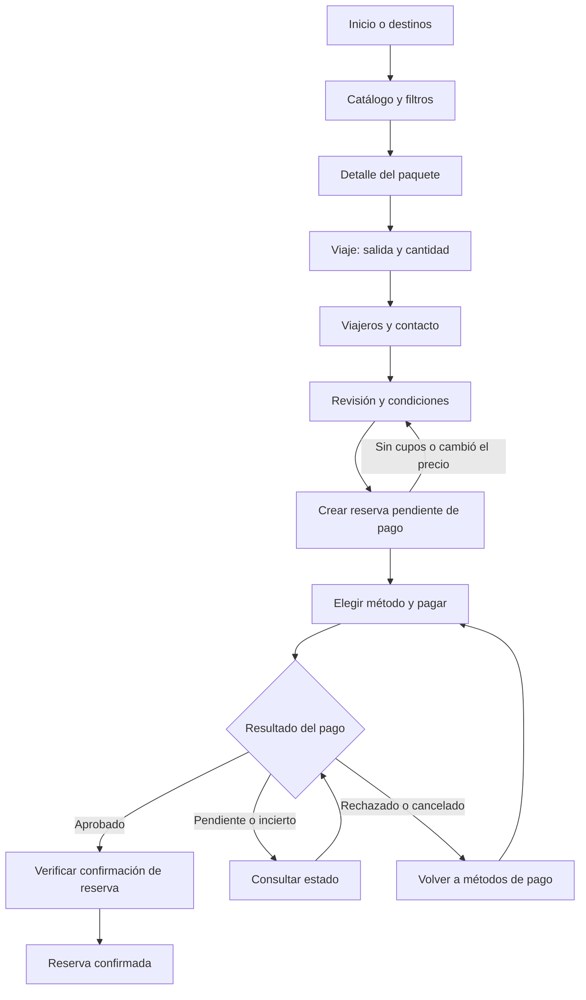

# Flujos de exploración, reserva y pago

Estado: propuesta funcional para la primera versión visual de VivaPeru. Se aplica el sistema de diseño VivaPeru y la arquitectura Angular definida en [arquitectura-frontend.md](arquitectura-frontend.md).

## 1. Decisiones de partida

- Explorar y reservar como invitado; la cuenta de usuario queda para una etapa posterior.
- Reservar un paquete y una salida por operación, con uno o varios viajeros.
- Mostrar precios en soles y pagar el total de la reserva en esta primera versión.
- Incluir tarjeta y billetera digital como métodos de demostración. La billetera podrá representarse como Yape/Plin, siempre identificada como simulación. La disponibilidad real dependerá de la pasarela elegida más adelante.
- No incluir inicialmente carrito con varios paquetes, pagos parciales, cupones, transferencias bancarias ni gestión de reembolsos.
- Mantener una indicación visible de demostración en reserva, pago y resultado. Los datos de contacto y viajeros serán ficticios.

Estas son decisiones propuestas de alcance, no restricciones definitivas del negocio.

## 2. Recorrido principal



El reintento desde métodos de pago requiere un intento anterior terminado y una reserva todavía vigente. El resultado aprobado puede mostrar temporalmente «Pago recibido; estamos confirmando tu reserva» antes de llegar a confirmada.

## 3. Exploración

| Paso | Qué ve y hace la persona | Resultado |
| --- | --- | --- |
| Inicio | Busca destino y, opcionalmente, fecha y cantidad de viajeros; explora destacados. | Catálogo con criterios aplicados. |
| Destinos | Explora Cusco, Arequipa, Puno, Ica, Lima u otros destinos de prueba. | Catálogo filtrado por destino. |
| Catálogo | Filtra por destino, precio y duración; ordena por relevancia o precio. | Lista y contador de resultados actualizados. |
| Detalle | Revisa galería, itinerario, duración, punto de encuentro, incluidos, no incluidos y condiciones. | Comprende la experiencia y sus requisitos. |
| Disponibilidad | Selecciona salida y cantidad de viajeros, y revisa el importe calculado. | Puede continuar a reserva si la combinación es válida. |

Acciones principales: **Explorar paquetes**, **Ver experiencia** y **Reservar experiencia**.

Reglas de exploración:

- La búsqueda permite navegar sin fecha; el catálogo distingue precio «desde» de precio de una salida concreta.
- El precio inicial por viajero no se presenta como total de una reserva.
- Los filtros y el orden se reflejan en parámetros de consulta. Al volver del detalle se conservan y se recupera la posición del catálogo cuando sea posible.
- El buscador inicial puede filtrar por fecha y cantidad cuando se indiquen; esos criterios se conservan al abrir un detalle y se vuelven a comprobar contra sus salidas.
- Las fechas agotadas aparecen como no disponibles; la persona puede elegir otra salida.
- Si no hay resultados, se ofrece limpiar filtros. Si hay error, se conservan los criterios y se ofrece reintentar.
- En móvil, los filtros se muestran en un panel y el botón de reserva permanece accesible sin cubrir contenido.

## 4. Reserva: tres pasos

El formulario usa un indicador **Viaje → Viajeros → Revisión**. El pago ocupa una pantalla posterior, asociada a una reserva ya creada.

### Paso 1: viaje

- Mostrar paquete, destino, salida, duración y cantidad de viajeros.
- Recuperar la selección hecha en el detalle; permitir modificarla.
- Validar fecha seleccionable, cantidad entera positiva y cupos de prueba suficientes.
- Mostrar precio por viajero y total. Los ejemplos iniciales usarán una tarifa única por viajero; tarifas por edades u opciones deberán modelarse cuando exista una política definida.
- Acción: **Continuar con viajeros**.

### Paso 2: viajeros y contacto

- Datos de contacto: nombres, apellidos, correo y teléfono con prefijo internacional.
- Datos básicos de cada viajero: nombres y apellidos; el contacto puede copiarse como primer viajero.
- La cantidad de fichas de viajeros corresponde a la cantidad elegida. Al reducirla con datos ya ingresados se pide confirmación antes de descartar fichas.
- Mostrar errores junto al campo, conservar datos válidos y enfocar el primer error al continuar.
- No solicitar documentos de identidad en la demostración. Los requisitos del operador se definirán al integrar servicios reales.
- Acciones: **Volver a viaje** y **Revisar reserva**.

### Paso 3: revisión

- Resumen del paquete, salida, punto de encuentro, viajeros y contacto.
- Desglose del importe: cantidad × precio por viajero y total final. Todo cargo aplicable deberá mostrarse antes de continuar.
- Condiciones de cancelación y aceptación de condiciones, con acceso al texto. En la demostración se indicará que el contenido es ilustrativo.
- Enlaces **Editar viaje** y **Editar viajeros**, conservando el borrador.
- Acción: **Continuar al pago**.

Al continuar se revalidan cupos y precio y se crea una sola reserva pendiente de pago. Si cambia el precio, se muestra el nuevo desglose y se requiere revisar y continuar otra vez. Si faltan cupos, se vuelve al paso de viaje con los datos de contacto conservados.

El botón queda ocupado durante la operación. Ante una respuesta incierta de creación se recupera la misma operación; no se crea otra reserva automáticamente.

### Borrador y navegación

El borrador mantiene datos y paso en la misma sesión. Volver o recargar no envía formularios ni crea reservas. Abrir un paso sin requisitos previos completos dirige al primer paso incompleto. Cambiar salida o cantidad invalida el importe revisado y exige revisar de nuevo.

Los datos de viajeros no se incorporan a las URLs. En el mock se usa sessionStorage solo con datos ficticios. La persistencia y recuperación de datos personales reales se diseñarán con el backend.

## 5. Pago

La pantalla muestra código de reserva, experiencia, salida, viajeros, importe final y método elegido. Incluye un acceso al resumen sin perder la operación.

| Método de prueba | Interfaz propuesta | Comportamiento simulado |
| --- | --- | --- |
| Tarjeta | Tarjeta ficticia predefinida e indicación «Datos de prueba». | Elegir escenarios aprobado, rechazado o respuesta incierta. |
| Billetera digital | QR ilustrativo no pagable, importe y referencia de demostración. | Iniciar en pendiente y permitir simular aprobación, rechazo o vencimiento. |

Los controles para seleccionar escenarios estarán identificados como herramientas de demostración. No se introducirán tarjetas reales ni se producirán cobros. La integración futura de tarjeta usará la interfaz segura del proveedor elegido; la aplicación no guardará número de tarjeta ni CVV.

Acción de tarjeta: **Simular pago de S/ …**. Para billetera: **Generar QR de prueba** y **Consultar estado**. El importe visible en el botón coincide con el resumen.

La primera versión simulará una vigencia de 15 minutos desde la creación de la reserva pendiente, configurable en el mock. Se mostrará como vigencia de demostración, sin afirmar que bloquea inventario real. Con APIs, la política de retención y su vencimiento serán devueltos por el backend.

### Resultados y recuperación

| Situación | Mensaje y acción |
| --- | --- |
| Pago aprobado y reserva confirmada | Mostrar confirmación, código, detalle e importe pagado de prueba. |
| Pago aprobado, reserva aún en confirmación | «Pago recibido; estamos confirmando tu reserva». Consultar estado; no volver a pagar. |
| Pago pendiente | Mostrar estado persistente y **Consultar estado**; no ofrecer un segundo pago simultáneo. |
| Rechazo definitivo | Explicar el rechazo con un mensaje comprensible y permitir otro intento o método sobre la misma reserva vigente. |
| Cancelación del intento | Regresar a la selección de método; la reserva sigue pendiente mientras esté vigente. |
| Sin respuesta o corte de conexión | «Estamos verificando el resultado». Consultar la operación existente antes de habilitar otro intento. |
| Vencimiento sin pago en curso | Desactivar nuevos intentos y ofrecer **Revisar disponibilidad**, conservando datos y recalculando el importe. |
| Vencimiento con pago pendiente o incierto | Verificar el pago y la reserva antes de declarar el resultado final; no iniciar otro pago mientras se resuelve. |
| Reserva no encontrada en la sesión de prueba | Mostrar un estado vacío con acceso al catálogo y explicar que no hay datos de esa reserva en esta sesión. |

Al volver desde un proveedor futuro o recargar la pantalla, se consulta el estado de la operación. Un parámetro de URL como `success=true` no confirma ni el pago ni la reserva. La futura API verificará la operación con la pasarela y actualizará sus estados.

La confirmación incluye un resumen imprimible o descargable cuando esa función se implemente. El correo se muestra como contacto; no se afirma haber enviado una confirmación en la versión de prueba.

## 6. Estados separados

El borrador pertenece al formulario y todavía no es una reserva creada.

| Entidad | Estados propuestos |
| --- | --- |
| Reserva | `pendiente_pago`, `confirmando`, `confirmada`, `expirada`, `cancelada` |
| Intento de pago | `creado`, `procesando`, `pendiente`, `aprobado`, `rechazado`, `cancelado`, `expirado` |
| Consulta de interfaz | `cargando`, `disponible`, `error`, `resultado_incierto` |

`resultado_incierto` describe lo que conoce la interfaz; no significa que el pago fue rechazado.

Transiciones principales de reserva:

```text
pendiente_pago → confirmando → confirmada
pendiente_pago → expirada, cuando no queda un pago por resolver
pendiente_pago → cancelada, por abandono explícito sin pago en curso
```

Un rechazo o la cancelación de un intento no cancelan por sí mismos la reserva. Un nuevo intento conserva el ID de reserva y recibe un ID de intento distinto. La interfaz de cancelación de reserva no se ofrece mientras exista un pago pendiente o incierto. Las anulaciones posteriores a la confirmación y los reembolsos quedan fuera de este alcance inicial.

Con APIs, el servidor decidirá las transiciones, la disponibilidad y el importe. Las operaciones de creación y pago deberán poder reintentarse con la misma clave de idempotencia cuando el resultado sea incierto. Esa clave se conserva para reintentos de una misma operación; un nuevo intento deliberado tras un rechazo definitivo recibe otra clave. Deshabilitar un botón será una protección visual adicional.

## 7. Rutas y responsables

| Ruta | Funcionalidad | Contenido |
| --- | --- | --- |
| `/` | inicio | Presentación y acceso a búsqueda. |
| `/destinos` | destinos | Exploración por destino. |
| `/paquetes` | paquetes | Catálogo; filtros en query params. |
| `/paquetes/:slug` | paquetes | Detalle y disponibilidad. |
| `/reservar/:paqueteId` | reservas | Borrador y formulario de tres pasos. |
| `/reservas/:id` | reservas | Resumen y acción disponible según estado. |
| `/reservas/:id/pago` | pagos | Método e intento de pago de la reserva. |
| `/reservas/:id/resultado` | reservas + pagos | Estado consultado y siguientes acciones. |

Una reserva confirmada que abra la ruta de pago se dirige al resultado. Una reserva expirada muestra recuperación de disponibilidad. El pago de un ID desconocido no muestra controles de cobro. Estas reglas de navegación se ejecutarán después de recuperar el estado; en producción el backend también deberá autorizar el acceso a cada reserva. Conocer un ID no será autorización suficiente.

## 8. Componentes visuales

- Exploración: buscador, filtros, orden, tarjeta de paquete y galería.
- Reserva: indicador de pasos, selector de salida, contador de viajeros, formularios y resumen de precio.
- Pago: selector de método, panel de demostración, vigencia y estado del intento.
- Resultado: tarjeta de estado con texto e icono, código y siguientes acciones.

La acción principal usa el acento terracota y un único botón dominante por paso. El resumen queda fijo en escritorio y se integra en el flujo en móvil. El diseño mantiene foco visible y una navegación de pasos accesible.

SweetAlert2 se reserva para confirmar el descarte de datos o la cancelación explícita de una reserva pendiente. Los errores de campos se muestran junto al campo; los estados de pago y confirmación permanecen en la página, para poder consultarlos después de cerrar una alerta.

## 9. Contratos de datos propuestos

| Funcionalidad | Operaciones |
| --- | --- |
| Paquetes | `listar(filtros)`, `obtenerPorSlug(slug)`, `consultarSalidas(paqueteId)` |
| Reservas | `cotizar(solicitud)`, `crearReserva(solicitud, claveOperacion)`, `obtenerReserva(id)`, `cancelarReserva(id)` |
| Pagos | `crearIntento(reservaId, metodo, claveOperacion)`, `obtenerIntento(id)`, `consultarEstado(reservaId)` |

La cotización incluye moneda, importes, desglose y referencia de precio. Crear la reserva vuelve a validar esa referencia. La reserva conserva el precio y el resumen aceptados; el intento de pago se asocia a ella y no acepta como definitivo un importe decidido por el navegador.

El mock expone los mismos contratos que las implementaciones HTTP futuras. La selección de escenarios de demostración pertenece al mock, no al contrato de negocio.

## 10. Escenarios de aceptación de la maqueta

1. Encontrar un paquete, reservar como invitado, simular pago aprobado y ver la confirmación con el mismo total.
2. Volver del detalle al catálogo conservando filtros; completar el flujo en móvil.
3. Buscar sin resultados o simular un error y recuperar la búsqueda sin perder criterios.
4. Impedir fechas inválidas, cantidades incorrectas y avance con campos obligatorios incompletos.
5. Editar viaje o viajeros desde revisión, mantener datos compatibles y actualizar el total.
6. Simular cambio de precio o falta de cupos antes de crear la reserva, sin llevar al pago un importe desactualizado.
7. Hacer doble clic o recargar sin duplicar la reserva ni un intento de pago.
8. Rechazar un pago y reintentar sobre la misma reserva con un intento distinto.
9. Mantener un pago pendiente o incierto y recuperar su resultado sin habilitar otro cobro.
10. Simular pago aprobado con reserva aún en confirmación y recuperar la confirmación sin volver a pagar.
11. Vencer la reserva o el QR y ofrecer el siguiente paso correcto; si hay un pago sin resolver, consultarlo antes.
12. Abrir un ID desconocido o una URL de resultado alterada sin mostrar una confirmación inexistente.

## 11. Decisiones para una etapa posterior

Elegir pasarela y métodos reales, definir la política de retención de cupos, tarifas por edades, documentos exigidos por el operador, condiciones comerciales, autenticación o recuperación segura de reservas de invitados y envío de comprobantes. Estas decisiones no impiden construir y probar ahora los recorridos de demostración.
